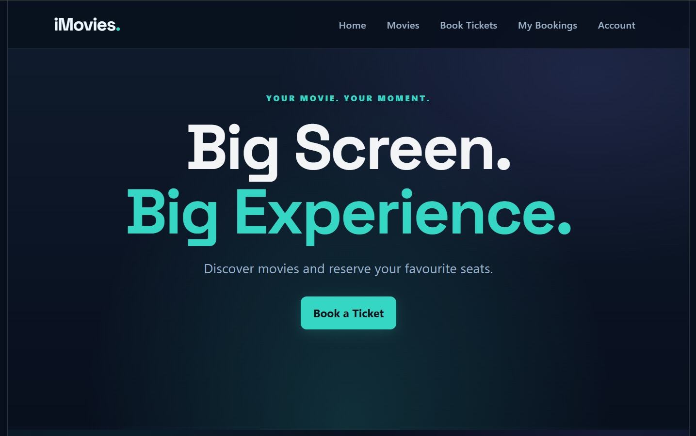
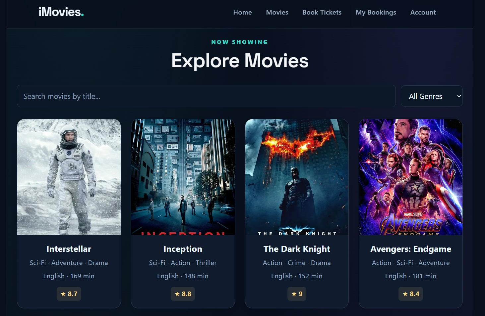
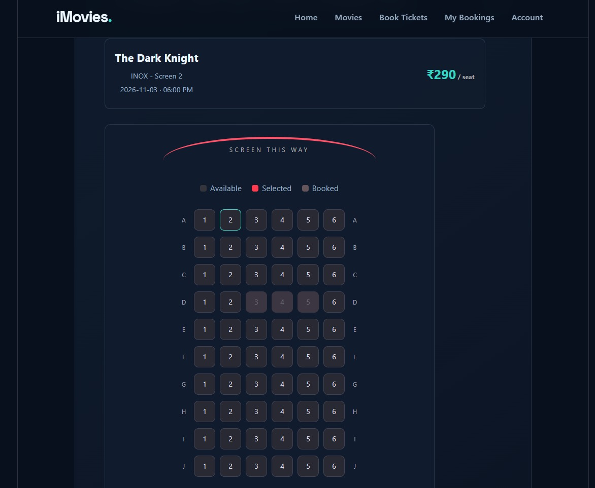
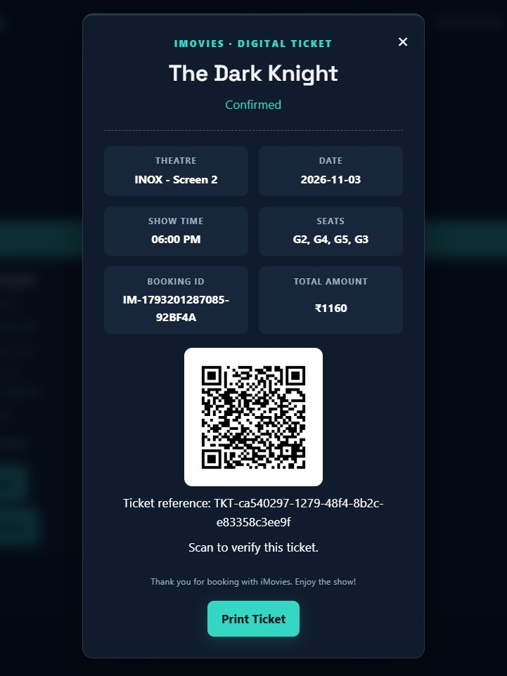
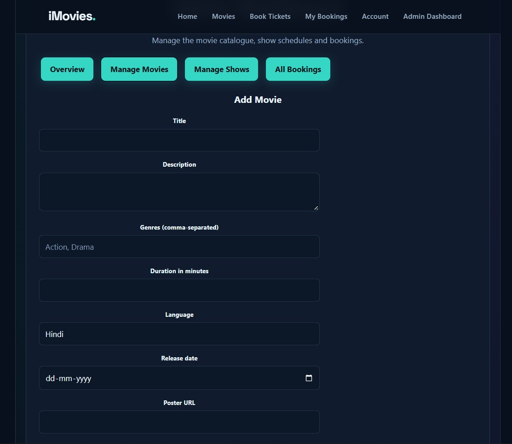

# iMovies — Movie Ticket Booking Made Simple

**A Full-Stack Web Application for Online Movie Ticket Booking**

iMovies is a full-stack web application developed to simplify the movie ticket booking process. Users can explore movies, view available shows, select seats, complete a simulated checkout, and access digital tickets. The application also provides administrative functionality for managing movie-related data and viewing booking information.

The project demonstrates the integration of a React frontend, an Express and Node.js backend, and a MongoDB database to implement a movie booking workflow.

> **Project status:** Academic demonstration project. Checkout and refund-related behavior is simulated; no real payment provider is integrated.

---

## 1. Project Overview

### Problem Statement

Moviegoers need a convenient way to discover movies, check showtimes, choose seats, and keep track of their bookings. A centralized web application can bring these activities together in one interface.

### Project Objective

The primary objective of iMovies is to develop a user-friendly movie ticket booking platform that integrates movie discovery, show management, seat selection, booking records, and digital ticket access.

### Scope of the Project

The application covers:

- Movie discovery and browsing.
- Show and theatre information.
- Seat selection and booking management.
- User authentication and role-based access.
- Digital tickets with QR codes.
- Administrative movie and show management.

## 2. Key Features

### Customer Module

- **User Authentication:** Registration and login using a JWT-based authentication flow.
- **Movie Discovery:** Browse movie posters, descriptions, genres, ratings, languages, and other movie details.
- **Show Information:** View show listings, theatre names, dates, times, and ticket prices.
- **Seat Selection:** Select seats from the available seating layout.
- **Booking Management:** Create bookings and view booking history.
- **Digital Tickets:** Access ticket details, QR codes, and ticket verification.
- **Cancellation:** Cancel eligible bookings through the application's demonstration workflow.

### Administrator Module

- **Role-Based Access:** Restrict administrative functionality to authorized admin accounts.
- **Movie Management:** Manage movie information.
- **Show Management:** Manage show schedules and related information.
- **Booking Overview:** Review booking information through the admin dashboard.

---

## 3. Application Screenshots

Ensure the image paths and filenames below match the files in your `screenshots/` folder.

### 3.1 Home Page



The landing page introduces the application and provides access to the movie browsing experience.

### 3.2 Explore Movies



The movie browsing interface presents available movies and supports discovery through the application's browsing and filtering features.

### 3.3 Seat Selection



The seat selection interface allows users to choose available seats before proceeding with their booking.

### 3.4 Digital Ticket



The digital ticket interface displays booking information and provides QR-based ticket access.

### 3.5 Administrator Dashboard



The administrator dashboard provides an overview of booking-related information and access to administrative operations.

---

## 4. Technology Stack

| Component | Technologies |
|---|---|
| Frontend | React, Vite, JavaScript, CSS |
| Backend | Node.js, Express.js |
| Database | MongoDB Atlas, Mongoose |
| Authentication | JSON Web Tokens (JWT), password hashing |
| Communication | REST API |
| Ticketing | QR code generation and ticket verification |
| Development Tools | Visual Studio Code, Git, GitHub |

---

## 5. System Architecture

The application follows a client-server architecture.

1. **Presentation Layer:** The React frontend provides the user interface for browsing movies, selecting seats, and managing bookings.
2. **Application Layer:** The Express backend processes API requests, applies authentication and authorization checks, and executes booking-related operations.
3. **Data Layer:** MongoDB stores application data, including users, movies, shows, and bookings.
4. **Ticketing Layer:** Ticket-related functionality provides QR codes and ticket verification.

```text
         User / Administrator
                  |
                  v
        React + Vite Frontend
                  |
                  v
        Express REST API
                  |
          +-------+-------+
          |               |
          v               v
   Authentication    Business Logic
          |               |
          +-------+-------+
                  |
                  v
                MongoDB
                  |
                  v
       Booking and Ticket Data
```

See [System Architecture](docs/architecture.md) for the architecture diagram.

---

## 6. Database Design

The application uses MongoDB with Mongoose models to organize its principal entities.

| Entity | Purpose |
|---|---|
| User | Stores user details and access roles. |
| Movie | Stores movie descriptions, genres, ratings, and poster information. |
| Show | Stores movie references, theatre details, schedules, prices, and seat information. |
| Booking | Stores booking identifiers, user references, selected seats, amounts, and booking status. |

The data model connects movies to their shows and shows to their bookings.

Refer to the [Entity Relationship Diagram](docs/er-diagram.md) for the data model overview.

---

## 7. Project Structure

```text
IMovies/
├── client/                  # React + Vite frontend
│   ├── public/
│   └── src/
├── server/                  # Node.js + Express backend
│   ├── models/
│   ├── routes/
│   ├── middleware/
│   └── server.js
├── docs/
│   ├── architecture.md
│   ├── er-diagram.md
│   └── user-flow.md
├── screenshots/
├── .gitignore
└── README.md
```

This structure summarizes the principal project directories; additional files may be present.

---

## 8. Installation and Setup

### Prerequisites

- Node.js and npm.
- A MongoDB database, such as a MongoDB Atlas cluster.
- Git.
- A modern web browser.

### Step 1: Clone the Repository

```bash
git clone https://github.com/YOUR_USERNAME/imovies.git
cd imovies
```

Replace `YOUR_USERNAME` with the GitHub repository owner's username.

### Step 2: Configure and Start the Backend

```bash
cd server
npm install
```

Create a `.env` file inside the `server` directory using the environment variable names expected by the backend:

```dotenv
PORT=5000
MONGO_URI=your_mongodb_connection_string
JWT_SECRET=your_long_random_secret
CLIENT_URL=http://localhost:5173
SERVER_PUBLIC_URL=http://localhost:5000
```

Use the applicable variables from your implementation. `CLIENT_URL` and `SERVER_PUBLIC_URL` may be optional depending on the configuration.

Start the backend using the development script defined in `server/package.json`, for example:

```bash
npm run dev
```

### Step 3: Configure and Start the Frontend

Open a second terminal:

```bash
cd client
npm install
npm run dev
```

Open the local URL printed by Vite, typically `http://localhost:5173`.

Configure the frontend API base URL according to the environment variables or settings used in `client/src/api.js`.

> **Security:** Never commit your actual `.env` file, MongoDB connection string, or JWT secret to GitHub.

---

## 9. API Organization

The backend organizes its REST endpoints into the following route groups.

| Route Prefix | Responsibility |
|---|---|
| `/api/auth` | User registration and authentication |
| `/api/movies` | Movie-related operations |
| `/api/shows` | Show-related operations |
| `/api/bookings` | Booking, checkout, and cancellation |
| `/api/admin` | Administrative operations |
| `/api/tickets` | Ticket QR and verification operations, if mounted |

Refer to the corresponding route files for the implemented HTTP methods and request formats.

---

## 10. Testing and Validation

Use this checklist to evaluate the application's principal workflows. Mark items complete only after testing the corresponding functionality.

- [ ] Backend starts and connects to MongoDB.
- [ ] Movie data loads correctly in the frontend.
- [ ] Registration and login function correctly.
- [ ] Movie browsing and show information work as expected.
- [ ] Unavailable seats cannot be selected.
- [ ] Simulated checkout creates a booking.
- [ ] Booking history and digital ticket details are accessible.
- [ ] Ticket QR and verification functionality work as intended.
- [ ] Cancellation updates booking status and seat availability as intended.
- [ ] Admin-only operations enforce role-based authorization.
- [ ] Environment secrets are excluded from version control.

---

## 11. Limitations and Future Enhancements

### Current Limitations

- **Simulated payments:** Checkout does not process real financial transactions.
- **Simulated refunds:** Updating booking status does not issue an actual refund.
- **Concurrent seat reservations:** Production deployment requires stronger atomic reservation and cancellation handling.
- **Production security:** Additional hardening, including rate limiting, secure deployment configuration, and comprehensive validation, is necessary.

### Future Enhancements

- Integration with a real payment gateway and verified payment webhooks.
- Atomic seat reservation to prevent double booking.
- Automated email confirmations and booking notifications.
- Enhanced booking analytics and reporting.
- Production deployment with HTTPS and improved security controls.

---

## 12. Project Documentation

Additional project documentation is available in the `docs/` directory.

- [System Architecture](docs/architecture.md)
- [Entity Relationship Diagram](docs/er-diagram.md)
- [User and Administrator Flow](docs/user-flow.md)

These documents explain the system structure, data relationships, and principal application workflows.

---

## 13. Conclusion

iMovies demonstrates the development of a full-stack movie ticket booking application using the MERN technology ecosystem. It brings together authentication, movie discovery, show management, seat selection, booking records, and digital ticket functionality in a single web application.

The project provides practical experience in frontend development, REST API design, database integration, authentication, role-based authorization, and software documentation.

**Project Type:** Academic / Educational  
**Repository:** https://github.com/Anurag-Jadhav-1212/IMovies

---

## License

No open-source license is specified unless a license file is added to the repository.
