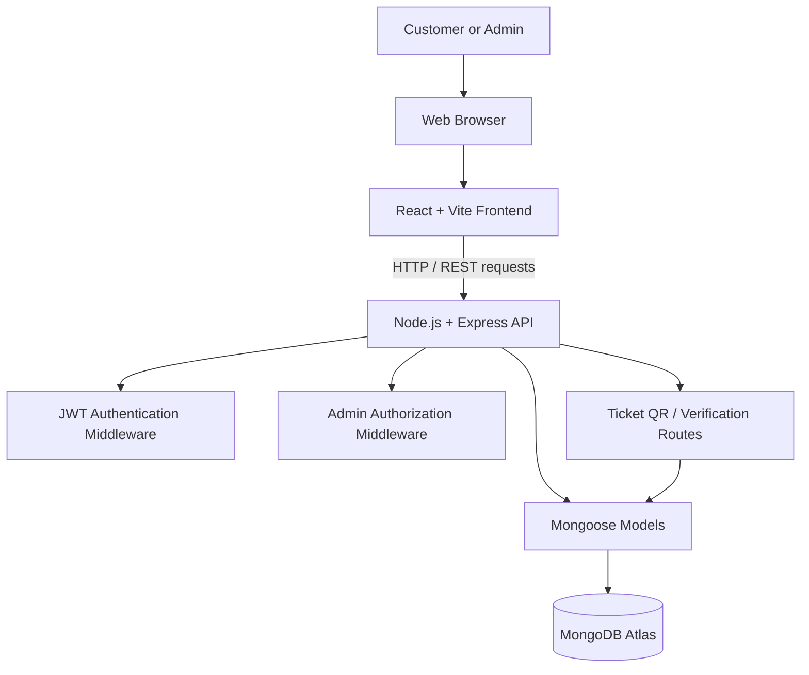

# iMovies System Architecture

## Overview

iMovies follows a client–server architecture. The React/Vite client sends HTTP requests to an Express REST API. The backend validates requests, applies authentication/authorization where required, and reads or writes application data through Mongoose models in MongoDB.

## Architecture diagram

The diagram is a logical overview. Middleware is applied only to the routes that require it; not every request necessarily passes through both authentication and admin authorization middleware.

## Main components

### Frontend (`client/`)

- Renders movie listings, movie/show details, seat selection, checkout, booking history, ticket information, and admin views.
- Uses the API helper in `client/src/api.js` to communicate with the backend.
- Sends the authentication token with protected requests according to the existing client implementation.
- Displays the success or error response returned by the API.

### Backend (`server/`)

- Runs on Node.js and Express.
- Exposes REST route groups, including `/api/auth`, `/api/movies`, `/api/shows`, `/api/bookings`, and `/api/admin`.
- May mount `/api/tickets` for QR retrieval and ticket verification.
- Uses middleware to verify JWTs and restrict admin-only operations.
- Uses Mongoose models to validate and persist data in MongoDB.

### Database

MongoDB stores user, movie, show, and booking documents. Shows reference movies, and bookings reference shows. A booking also records selected seats, amount, and its current status.

## Request flow

1. A user interacts with the React interface.
2. The frontend sends a request to the appropriate API route.
3. Express routes validate inputs and apply the required authentication/authorization middleware.
4. The route reads or updates MongoDB through Mongoose.
5. The backend returns a JSON response.
6. The frontend updates the UI based on the response.

## Authentication and authorization

- Registration creates a regular user account by default.
- Login returns a JWT used by the client for authenticated API requests.
- Authentication middleware verifies the token and exposes the authenticated user context to protected routes.
- Admin middleware checks the user's role before allowing admin-only actions.
- A production system should never trust a role or user identifier supplied only by the browser; authorization must be checked on the server.

## Booking and ticket flow

1. The user selects a show and seats.
2. The client submits the show identifier and selected seats to the booking/checkout API.
3. The server processes the demo checkout and creates a booking if the request succeeds.
4. The booking is shown in the user's booking history.
5. The ticket UI can request a QR code and use a ticket reference for verification.
6. Cancellation updates the booking and attempts to release the seats according to the current implementation.

The current project is a demonstration. Atomic seat locking, payment-provider verification, and real refund processing are not implied by this flow.

## Environment configuration

The server may use these environment variables, depending on its current code:

- `PORT`: Express listening port.
- `MONGO_URI`: MongoDB connection string.
- `JWT_SECRET`: JWT signing/verification secret.
- `CLIENT_URL`: frontend origin, such as for CORS.
- `SERVER_PUBLIC_URL`: base URL used to create ticket verification links.

Keep real values in a local `.env` file. Commit only safe placeholders in an `.env.example` file, if one is included.

## Production considerations

- Use a real payment provider with server-side payment verification and webhooks.
- Reserve seats atomically or with database transactions.
- Make cancellation and refund handling consistent and idempotent.
- Validate all request data and protect against abusive traffic.
- Use HTTPS and production-appropriate token/session handling.
- Add automated tests, structured logs, and monitoring.
