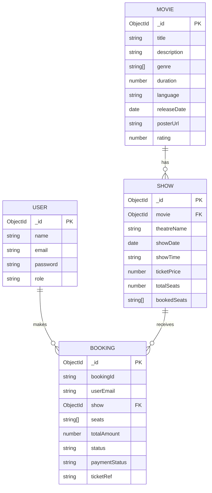

# iMovies Entity Relationship Diagram

## Overview

The main data entities in iMovies are User, Movie, Show, and Booking. A show belongs to one movie. A booking refers to one show and identifies the customer who made the booking.

## ER diagram

## Entity descriptions

### User

Represents a registered customer or administrator. The `role` distinguishes ordinary users from admins. Passwords should be stored as hashes, never as plaintext.

### Movie

Stores the information displayed on movie cards and details pages, including title, description, genres, duration, language, release date, poster URL, and rating.

### Show

Represents a scheduled screening of a movie at a theatre. The `movie` field is a reference to the corresponding Movie document. `bookedSeats` stores seat labels that have been reserved according to the current application logic.

### Booking

Represents a user's booking for a particular show. It records the seats, total amount, booking status, and ticket/payment fields when those fields are present in the current schema. `userEmail` links the booking to the customer by email in the current design; if the schema is later changed to use a User ObjectId, update this diagram accordingly.

## Relationships

- **Movie → Show:** One movie can have many scheduled shows; each show references one movie.
- **Show → Booking:** One show can have many bookings; each booking references one show.
- **User → Booking:** One user can make many bookings. The current booking schema uses `userEmail`, so this is a logical relationship rather than necessarily a direct MongoDB ObjectId reference.

## Implementation notes

- MongoDB documents have their own `_id` values.
- `Show.movie` should be stored as an ObjectId reference matching an existing Movie `_id`, not as a movie title.
- If using MongoDB Extended JSON to import data, ObjectId values can be represented as `{ "$oid": "..." }`.
- This diagram is based on the model fields described in the project notes. If your actual model files differ, treat those files as authoritative and update this diagram to match.
