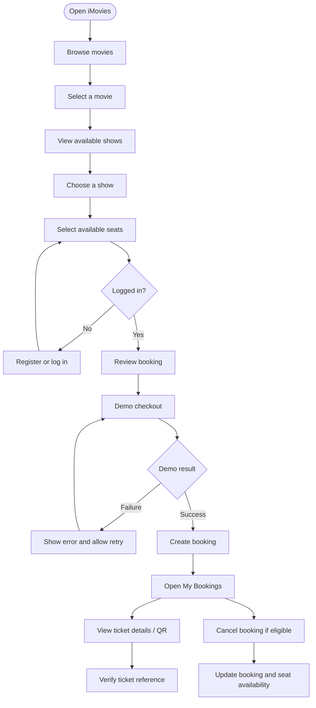
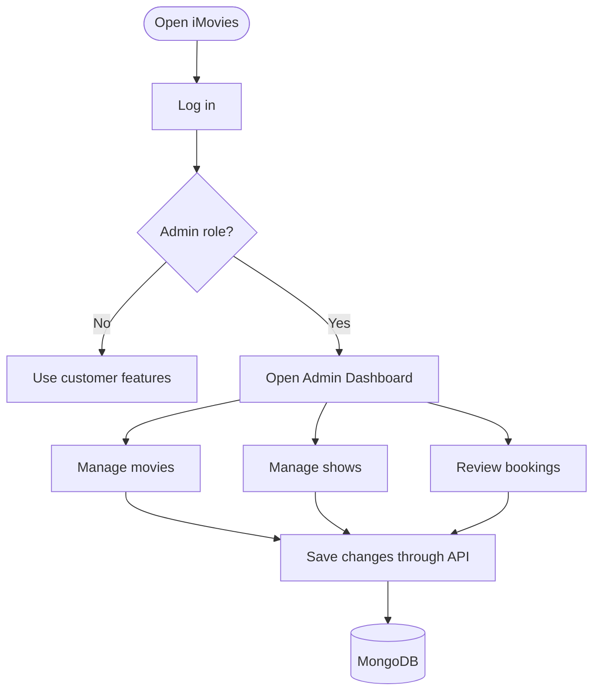

# iMovies User Flow

## Customer booking flow

The exact order of login and seat selection may differ in the interface. This diagram shows the intended high-level flow rather than every UI condition.

## Admin flow

Admin access must be enforced by backend role checks, not merely by hiding admin controls in the frontend.

## Main customer actions

1. Browse available movies.
2. Select a movie and choose a showtime.
3. Choose seats that are available.
4. Complete the simulated checkout.
5. Review the booking in My Bookings.
6. Open ticket details and QR code.
7. Cancel an eligible booking if needed.

## Failure and edge cases to test

- Login credentials are invalid or the token is missing/expired.
- A requested movie or show does not exist.
- A selected seat is already booked or becomes unavailable before checkout.
- Demo checkout fails.
- Booking creation fails after a seat reservation attempt.
- A user tries to view or cancel another user's booking.
- A non-admin attempts to call an admin-only API.
- A ticket is cancelled and its verification response should not imply it is still valid.

## Payment limitation

Checkout outcomes are simulated for demonstration. The app should not be described as processing real card payments or issuing actual refunds unless a payment provider and its server-side verification/refund workflow have been integrated.
